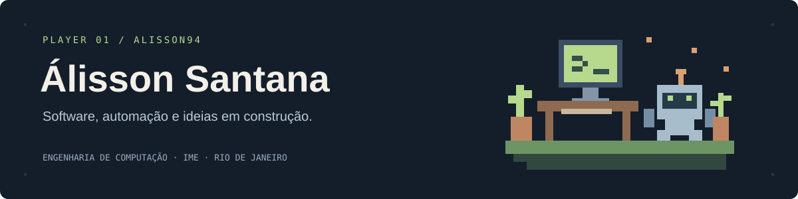

**Português** · [English](README.en.md)

### Olá, eu sou o Álisson.

Estudo **Engenharia de Computação no Instituto Militar de Engenharia (IME)**, no Rio de Janeiro. Gosto de entender como as coisas funcionam e transformar essa curiosidade em software — de sistemas web e automações a experimentos com jogos.

Tenho experiência com desenvolvimento web e chatbots com IA, pesquisa de desempenho em Python e programação de robôs na **RoboIME**, onde também liderei a equipe de programação.

Busco oportunidades de **estágio em desenvolvimento de software**, com interesse em backend, aplicações web e automação.

[LinkedIn](https://www.linkedin.com/in/alisson-nunes-santana/) · [Meus repositórios](https://github.com/alisson94?tab=repositories)

### Projetos para explorar

| Projeto | O que você encontra | Tecnologias |
| :--- | :--- | :--- |
| [Verificador de relatórios de compras](https://github.com/alisson94/verificador-relatorios-compras) | Conferência de indicadores a partir de CSV, validação de dados, cálculos com `Decimal` e testes automatizados. | Python |
| [Monitor de cotações](https://github.com/alisson94/desafio-asset-monitor) | Aplicação de console que consulta uma API de cotações e implementa alertas por e-mail com limites configuráveis. | C#, .NET, HTTP, SMTP |
| [Biblioteca de manhwas](https://github.com/alisson94/biblioteca-manhwas) | Catálogo pessoal com cadastro de obras, upload de capas e acompanhamento de capítulos. | JavaScript, Node.js, Express, EJS, MongoDB |
| [Tank Game Multiplayer](https://github.com/alisson94/tankGameMultiplayer) | Experimento de jogo no navegador com troca de eventos de movimento e disparo entre clientes e servidor. | JavaScript, Node.js, Socket.IO |

### Ferramentas que uso

- **Web:** TypeScript, JavaScript, React, Next.js e Node.js.
- **Backend e dados:** Python, Java, PHP, C#, SQL, MySQL, MongoDB e Supabase.
- **Automação e engenharia:** n8n, APIs, Git, Docker, C++ e LabVIEW.

### Além dos sistemas web

Na RoboIME, trabalhei na lógica de defesa dos robôs da categoria Small Size League. Na iniciação científica com o **Speedupy**, escrevi scripts para testar e comparar o desempenho de programas científicos.

Nos projetos pessoais, jogos são meu espaço para experimentar: renderização, interação e comunicação em tempo real.
